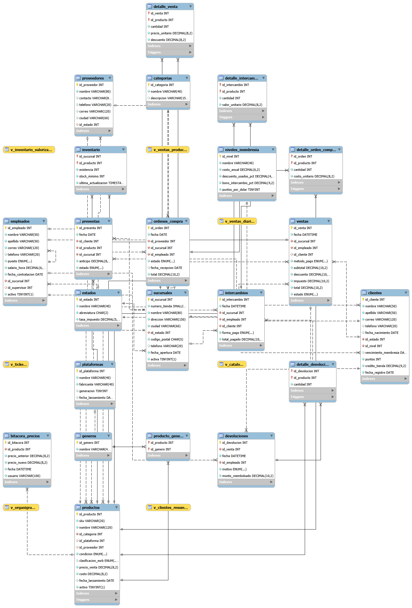
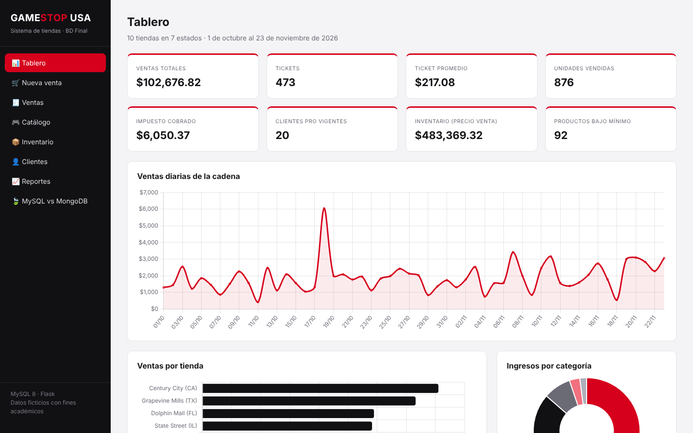
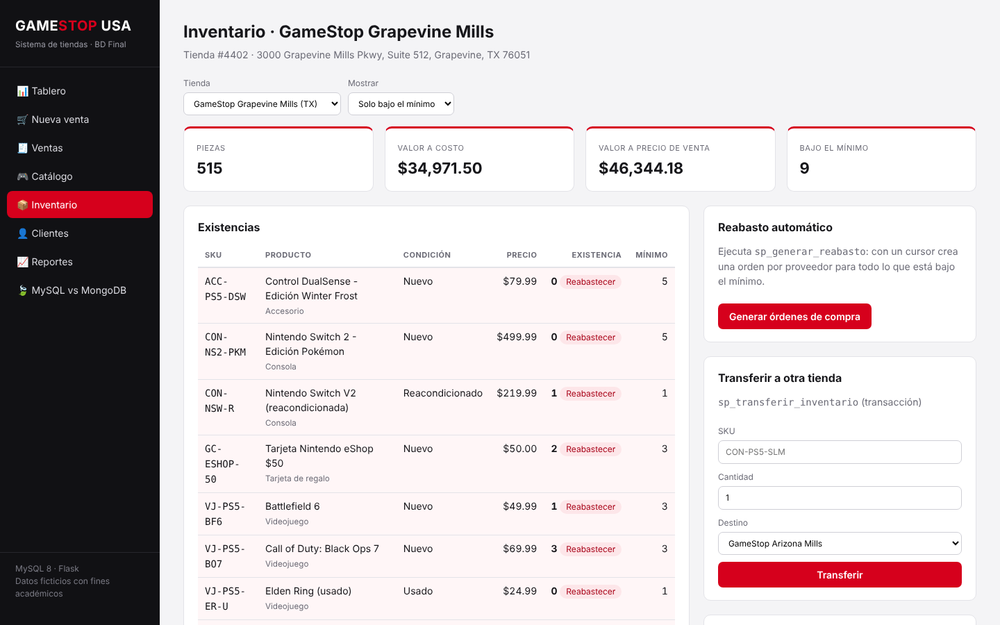

#  GameStop USA: base de datos para una cadena de tiendas de videojuegos

**Proyecto final de Bases de Datos.** Diseñamos la base de datos que usaría un distrito de **10 tiendas GameStop en 7 estados de EE. UU.** para operar durante la temporada más fuerte del año: octubre y noviembre de 2026, con el lanzamiento de *Grand Theft Auto VI* (19 de noviembre) y las ofertas anticipadas de Black Friday.

La base está hecha en **MySQL** y después se migró a **MongoDB**. Incluye una **interfaz web** para usarla y un script que comprueba que las dos versiones tienen exactamente la misma información.



---

## 1. ¿Qué problema resuelve?

GameStop no es una tienda común. Además de vender, **compra juegos y consolas usados** a sus clientes para revenderlos, tiene un programa de lealtad de pago (**GameStop Pro**) y opera en estados con **impuestos distintos**. Eso genera reglas que una hoja de cálculo no puede garantizar:

| Situación real | Qué hace la base de datos |
|---|---|
| Un cliente quiere comprar 3 consolas y solo quedan 2 en esa tienda | Rechaza la venta completa (trigger + transacción) |
| La misma venta cuesta distinto en California (7.25 %) que en Nueva York (4 %) | Toma la tasa del estado de la tienda automáticamente |
| Un cliente Pro compra un juego usado | Le aplica 10 % de descuento solo a los usados, y solo si su membresía sigue vigente |
| Alguien quiere "vender" a la tienda un juego nuevo como si fuera usado | Lo rechaza: en un intercambio solo entran usados o reacondicionados |
| Una devolución llega 35 días después de la compra | La rechaza (máximo 30 días) |
| En Black Friday se baja el precio de la PS5 | Guarda quién lo cambió, cuándo y de cuánto a cuánto. No permite dejarlo por debajo del costo |

El análisis completo (actores, 15 requerimientos funcionales, 16 reglas de negocio y casos de uso) está en [`docs/analisis.md`](docs/analisis.md).

---

## 2. Una venta, de principio a fin

Así se ve lo que pasa dentro de la base de datos cuando se registra una venta. Es el ticket **#122** de nuestros datos: **Marcus Thompson**, cliente **GameStop Pro** (vigente hasta abril de 2027), compra en **GameStop Mission Valley, San Diego, CA** el 18 de octubre de 2026.

| Artículo | Condición | Precio | Descuento Pro |
|---|---|---:|---:|
| Nintendo Switch 2 | Nuevo | $449.99 | — |
| God of War Ragnarök | **Usado** | $29.99 | **−$3.00** |
| Control DualSense | Nuevo | $74.99 | — |
| **Subtotal** | | **$554.97** | **−$3.00** |
| Impuesto de California (7.25 % sobre $551.97) | | $40.02 | |
| **Total cobrado** | | **$591.99** | |

Nadie capturó el descuento, el impuesto ni el total. Al insertar cada renglón en `detalle_venta`, los triggers:

1. **`trg_detalle_venta_bi`** (antes de insertar):
   - verifica que el producto esté activo y que la tienda tenga existencia;
   - toma el precio del catálogo;
   - llama a `fn_es_pro()` para saber si la membresía está vigente *en la fecha de la venta*;
   - como el juego es usado, calcula el 10 % de descuento.
2. **`trg_detalle_venta_ai`** (después de insertar):
   - descuenta las 3 piezas del inventario de Mission Valley;
   - recalcula el ticket con `fn_tasa_impuesto()`, que lee la tasa de `estados` a través de `sucursales`;
   - suma **1,101 puntos** al cliente (2 por dólar, por ser Pro).

Si cualquiera de los tres artículos hubiera fallado (por ejemplo, sin existencia), el procedimiento `sp_registrar_venta` hace `ROLLBACK` y **no se guarda nada**.

---

## 3. Lo que dicen los datos

Con los datos de ejemplo (1 de octubre al 23 de noviembre de 2026):

| Indicador | Valor |
|---|---|
| Ventas totales | **$102,676.82** en 473 tickets (ticket promedio $217.08) |
| Impuesto cobrado | $6,050.37 |
| Devoluciones | 14, por $2,509.07 (la causa más común: "No le gustó") |
| Intercambios | 30; en 21 el cliente prefirió crédito en tienda en vez de efectivo |
| Inventario al cierre | $483,369 a precio de venta ($370,428 a costo) |

**El lanzamiento de GTA VI se nota.** Antes del 19 de noviembre la cadena vendía en promedio **$1,805 al día**; del 19 al 23 de noviembre, **$2,851 al día (+58 %)**. GTA VI vendió 96 copias en 5 días (59 de PS5 y 37 de Xbox), más que cualquier otro juego del periodo.

**Las consolas son más de la mitad del dinero.** Generan el **57.7 %** de los ingresos, aunque son pocas piezas. Le siguen los videojuegos (28.7 %) y los accesorios (8.4 %).

**La tienda líder está en California.** *Century City* (Los Ángeles) cobró $16,207, seguida de *Grapevine Mills* (Texas, $14,642). La de menos ventas fue *Arizona Mills* ($5,265).

**Un hallazgo que no esperábamos:** los clientes **GameStop Pro gastaron menos por persona** ($1,107) que los del nivel gratuito ($1,341). El descuento Pro solo aplica a usados y casi todo lo que se vende es nuevo: en todo el periodo el descuento sumó apenas $92.40. Si fuera una empresa real, sería una señal para revisar los beneficios del programa.

Todas estas cifras salen de las vistas y consultas de [`mysql/06_consultas.sql`](mysql/06_consultas.sql) y de la página de reportes de la interfaz.

---

## 4. Decisiones de diseño (y por qué)

| Decisión | Por qué |
|---|---|
| La tasa de impuesto vive en `estados`, no en cada tienda ni en cada venta | Si Texas cambia su impuesto, se actualiza **un** renglón (3FN). La venta sí guarda el impuesto *cobrado*, porque ese no debe cambiar después |
| `detalle_venta.precio_unitario` repite el precio del producto | No es redundancia: es el precio **histórico**. El catálogo cambió 10 veces en el periodo (ver `bitacora_precios`) y los tickets viejos no deben cambiar |
| `inventario` es una tabla aparte (tienda × producto) | La alternativa, columnas `stock_tienda1`, `stock_tienda2`…, viola 1FN y obliga a modificar la tabla cada vez que abre una tienda |
| Los totales de la venta se guardan, pero solo los escriben los triggers | Los reportes no recalculan cientos de renglones, y nadie puede capturar un total incorrecto a mano |
| `empleados.id_supervisor` apunta a la misma tabla | El organigrama (gerente de distrito → gerente → subgerente → asesor) es de profundidad variable |
| Los beneficios del programa viven en `niveles_membresia` | Si GameStop cambia el descuento Pro de 10 % a 15 %, no hay que tocar ningún trigger |
| En MongoDB, los artículos y devoluciones van **dentro** de la venta | Un ticket siempre se consulta completo; lo que en MySQL son 4 tablas y 3 JOINs, en MongoDB es un solo documento |
| En MongoDB, el cliente se **referencia** (no se copia) en la venta | Sus puntos y su crédito cambian con cada compra; si se copiaran, quedarían desactualizados |

La justificación completa de 1FN, 2FN y 3FN está en [`docs/normalizacion.md`](docs/normalizacion.md), y cada columna de cada tabla en el [diccionario de datos](docs/diccionario_datos.md).

---

## 5. Cómo cubre la rúbrica

| Criterio | Dónde está |
|---|---|
| **Análisis** | [`docs/analisis.md`](docs/analisis.md) |
| **Estructura de la BD** | [`mysql/01_esquema.sql`](mysql/01_esquema.sql) (22 tablas), [diagrama EER](docs/diagrama_eer.png) y [modelo de Workbench](docs/modelo_gamestop.mwb), [diccionario de datos](docs/diccionario_datos.md), [normalización](docs/normalizacion.md) |
| **Funciones, procedimientos, consultas y reportes** | 4 funciones y 9 triggers ([`02`](mysql/02_funciones_triggers.sql)), 9 procedimientos ([`03`](mysql/03_procedimientos.sql)), 7 vistas ([`05`](mysql/05_vistas.sql)), 30 consultas ([`06`](mysql/06_consultas.sql)), roles y usuarios ([`07`](mysql/07_seguridad.sql)), pruebas ([`08`](mysql/08_pruebas.sql)), 8 reportes CSV en la interfaz |
| **Migración, estructura NoSQL y validación** | [`migracion/migrar.py`](migracion/migrar.py), colecciones con `$jsonSchema` en [`mongodb/`](mongodb/), [`migracion/validar.py`](migracion/validar.py) con su [reporte: 61/61 pruebas correctas](docs/reporte_validacion.md) |
| **Presentación (UI) y repositorio** | Interfaz web en [`app/`](app/) e [issues](https://github.com/carlos03123/BD-Final/issues?q=is%3Aissue) con el avance del proyecto |

---

## 6. Qué hay en cada carpeta

```
mysql/       01 esquema · 02 funciones y triggers · 03 procedimientos · 04 datos
             05 vistas · 06 consultas · 07 seguridad · 08 pruebas
mongodb/     01 colecciones con validación · 02 datos · 03 reglas de negocio · 04 consultas
migracion/   migrar.py (MySQL → MongoDB) · validar.py (compara las dos bases)
app/         interfaz web en Flask
docs/        análisis · normalización · diccionario · diagrama y modelo · reporte de validación · capturas
```

### Objetos de MySQL más importantes

| Objeto | Qué hace |
|---|---|
| `sp_registrar_venta` | Registra una venta completa en una **transacción**; recibe los artículos como **JSON** (`JSON_TABLE`) |
| `sp_generar_reabasto` | Recorre con un **cursor** los proveedores de productos bajo el mínimo y crea una orden de compra por proveedor |
| `sp_recibir_orden`, `sp_transferir_inventario` | Mueven inventario dentro de transacciones con `SELECT … FOR UPDATE` |
| `trg_detalle_devolucion_bi/_ai` | Plazo de 30 días; no devolver más de lo comprado; reembolso con impuesto; quitar puntos |
| `fn_valor_intercambio` | Paga 25 % en efectivo o 35 % en crédito; los Pro reciben 10 % extra en crédito |
| `trg_productos_au` | Escribe en `bitacora_precios` cada cambio de precio con el usuario de MySQL |
| `rol_vendedor` | Puede vender, pero de los clientes **solo puede modificar teléfono y correo** (privilegio por columna) |

En las consultas de `06_consultas.sql` hay `JOIN` de 5 tablas, auto-JOIN, `HAVING`, `EXISTS`/`NOT EXISTS`, subconsultas correlacionadas, `WITH` (CTE) y funciones de ventana (`ROW_NUMBER`, `RANK`, `LAG`, promedio móvil de 7 días).

---

## 7. Cómo ejecutarlo

**Requisitos:** MySQL 8.0.13 o superior con MySQL Workbench, MongoDB con mongosh o Compass, y Python 3.

**1. MySQL.** En Workbench, abre y ejecuta con ⚡ los archivos de `mysql/` **en orden** del `01` al `07`. El `08` es opcional: demuestra las reglas, pero agrega una venta de prueba.

**2. MongoDB.** En mongosh o en la pestaña *Mongosh* de Compass:
```bash
mongosh mongodb/01_colecciones.js
mongosh mongodb/02_datos.js
mongosh mongodb/04_consultas.js
mongosh mongodb/03_operaciones.js    # opcional, modifica datos
```

**3. Migración y validación** (en lugar de cargar `02_datos.js`, se pueden migrar los datos directo desde MySQL):
```powershell
pip install -r requirements.txt
$env:MYSQL_PASSWORD="tu_contraseña"           # en cmd: set MYSQL_PASSWORD=tu_contraseña
python migracion/migrar.py
python migracion/validar.py --reporte docs/reporte_validacion.md
```

**4. Interfaz web:**
```powershell
python app/app.py                             # abre http://127.0.0.1:5000
```

| | |
|---|---|
|  |  |
| *Tablero con indicadores y gráficas* | *La base de datos rechaza una venta sin existencia y la interfaz muestra el motivo* |
|  |  |
| *Inventario con alertas de reabasto* | *Reportes exportables a CSV* |

---

## 8. Problemas que encontramos y cómo los resolvimos

| Problema | Causa | Solución |
|---|---|---|
| El servicio de MySQL arrancaba y se detenía solo | Había restos de una instalación vieja mezclados con la configuración de MySQL 8; el log decía `unknown variable 'internal_tmp_mem_storage_engine'` | Desinstalar el servidor viejo, apartar su carpeta de datos e instalar una versión nueva limpia |
| `Illegal mix of collations` al registrar una venta | La base usaba `utf8mb4_unicode_ci` y la conexión de Workbench usa `utf8mb4_0900_ai_ci` (la de MySQL 8); `JSON_TABLE` devolvía texto con la otra | Usar la intercalación por defecto de MySQL 8 en toda la base |
| Workbench bloqueaba un `UPDATE` de prueba | El modo *Safe Updates* exige un `WHERE` con llave | Agregar `WHERE id_producto > 0` |
| En Black Friday, la PS5 quedaba **por debajo del costo** | El `CHECK (precio_venta >= costo)` y el trigger lo impidieron | Era correcto que lo rechazara; ajustamos el costo a uno realista |
| MongoDB: `exclusiveMinimum must be ... with minimum` | MongoDB usa la versión *draft 4* de JSON Schema, donde `exclusiveMinimum` es booleano | `minimum: 0, exclusiveMinimum: true` |
| MongoDB: `$documentNumber must be specified with ... exactly one element` | La función de ventana solo acepta un campo para ordenar | Ordenar solo por `unidades` |
| Al volver a correr un script en Compass: `Identifier 'D' has already been declared` | Las declaraciones `const` no se pueden repetir en la misma sesión | Usar `var` en el nivel superior de los scripts |

---

## 9. MySQL vs MongoDB en este proyecto

| | MySQL | MongoDB |
|---|---|---|
| Un ticket | 4 tablas (`ventas`, `detalle_venta`, `devoluciones`, `detalle_devolucion`) | 1 documento con arreglos |
| Inventario | Tabla `inventario` (tienda × producto) | Arreglo dentro de cada producto |
| Reglas de negocio | Triggers y procedimientos en la base | Funciones JavaScript (`03_operaciones.js`), con transacción si el servidor es replica set |
| Validación | `CHECK`, `FOREIGN KEY`, `ENUM`, `UNIQUE` | `$jsonSchema`, `$expr`, índices únicos. Las llaves foráneas no existen: `validar.py` revisa que no haya referencias huérfanas |
| Ranking / acumulados | `ROW_NUMBER()`, `RANK()`, `SUM() OVER` | `$setWindowFields` |
| Verificación | — | `validar.py`: **61 de 61 pruebas iguales** (conteos, totales por tienda/producto/cliente, referencias, `$jsonSchema`, 25 ventas campo por campo) |

---

##  Equipo

| Integrante | GitHub |
|---|---|
| Carlos | [@carlos03123](https://github.com/carlos03123) |
| Celeste Grageda | [@celestegrageda](https://github.com/celestegrageda) |
| Jesús | [@Jaime-duende](https://github.com/Jaime-duende) |

Los tres colaboramos en todas las etapas del proyecto: el análisis, el diseño y la programación de la base de datos en MySQL, la migración y validación en MongoDB, la interfaz web y la documentación.

> Los nombres de clientes y empleados, direcciones, teléfonos y correos son **ficticios**. Los precios están en dólares y no incluyen impuesto, como se acostumbra en EE. UU.
