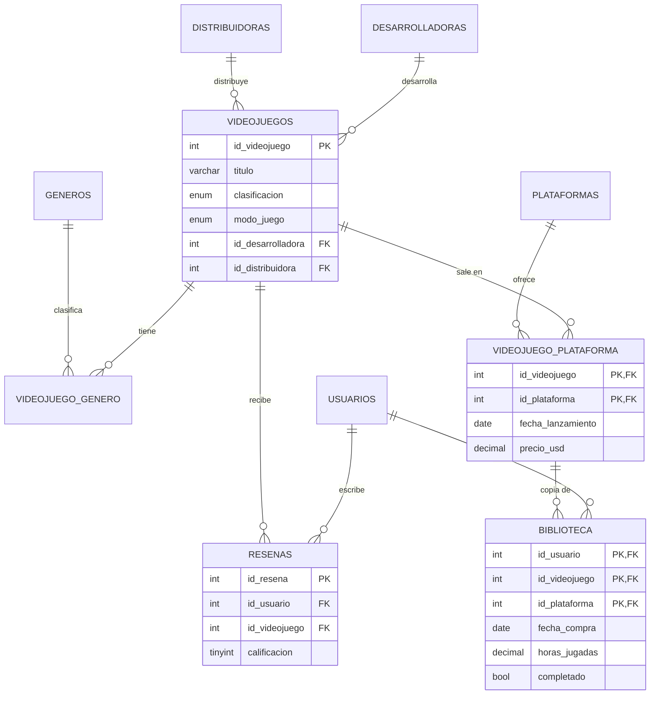

# 🎮 Base de datos de videojuegos

La misma base de datos de videojuegos hecha de dos formas:

- **MySQL (relacional)**: lista para abrir y ejecutar en **MySQL Workbench**
- **MongoDB (documental)**: lista para ejecutar en **mongosh** o **MongoDB Compass**

Guarda videojuegos con su estudio, distribuidora, géneros y plataformas (con fecha y precio por plataforma), además de usuarios, la biblioteca de juegos de cada uno (horas jugadas, si lo completó) y sus reseñas.

## 📁 Estructura

```
bd-videojuegos/
├── mysql/
│   ├── 01_esquema.sql                          # Crea la BD y las tablas
│   ├── 02_datos.sql                            # Datos de ejemplo
│   └── 03_vistas_procedimientos_consultas.sql  # Vistas, procedimiento, trigger y consultas
└── mongodb/
    ├── 01_crear_bd.js                          # Crea colecciones, validación, datos e índices
    └── 02_consultas.js                         # Consultas y agregaciones de ejemplo
```

## 🐬 MySQL

### Diagrama entidad-relación



**Tablas:** `desarrolladoras`, `distribuidoras`, `plataformas`, `generos`, `videojuegos`, `videojuego_genero` (N:M), `videojuego_plataforma` (N:M), `usuarios`, `biblioteca`, `resenas`.

**Extras:**
- Vistas `v_catalogo` (catálogo completo) y `v_ranking` (calificación promedio)
- Procedimiento `sp_biblioteca_usuario('carlos_gamer')`
- Trigger `trg_resena_requiere_juego`: no deja reseñar un juego que el usuario no tiene

### Cómo ejecutarlo en MySQL Workbench

1. Abre MySQL Workbench y conéctate a tu servidor local.
2. `File > Open SQL Script…` y abre `mysql/01_esquema.sql`.
3. Ejecuta todo con el rayo ⚡ (o `Ctrl+Shift+Enter`).
4. Repite con `02_datos.sql` y después con `03_vistas_procedimientos_consultas.sql`.
5. Refresca el panel **Schemas** y verás la base `videojuegos`.
6. Para ver el diagrama: `Database > Reverse Engineer…`, elige la base `videojuegos` y Workbench dibuja el modelo EER.

> Requiere MySQL 8.0.13 o más reciente.

## 🍃 MongoDB

En MongoDB los datos se agrupan en documentos en lugar de repartirse en muchas tablas:

| Colección     | Contenido |
|---------------|-----------|
| `videojuegos` | Cada juego lleva **dentro** su desarrolladora, distribuidora, géneros y plataformas (con fecha y precio). Tiene validación con `$jsonSchema`. |
| `usuarios`    | Cada usuario lleva **dentro** su biblioteca de juegos. |
| `resenas`     | Colección aparte que **referencia** al usuario y al juego (se unen con `$lookup`). |

Ejemplo de documento:

```json
{
  "_id": "elden-ring",
  "titulo": "Elden Ring",
  "clasificacion": "M",
  "desarrolladora": { "nombre": "FromSoftware", "pais": "Japón" },
  "distribuidora": "Bandai Namco",
  "generos": ["Acción", "RPG", "Mundo abierto", "Soulslike"],
  "plataformas": [
    { "nombre": "PlayStation 5", "fecha_lanzamiento": "2022-02-25", "precio_usd": 59.99 },
    { "nombre": "PC",            "fecha_lanzamiento": "2022-02-25", "precio_usd": 59.99 }
  ]
}
```

### Cómo ejecutarlo

Desde la terminal, en la carpeta del proyecto:

```bash
mongosh mongodb/01_crear_bd.js
mongosh mongodb/02_consultas.js
```

O en **MongoDB Compass**: abre la pestaña **Mongosh** (abajo), copia el contenido de `01_crear_bd.js`, pégalo y presiona Enter.

## 🔁 MySQL vs MongoDB en este proyecto

| Concepto                | MySQL                                   | MongoDB                               |
|-------------------------|-----------------------------------------|---------------------------------------|
| Géneros de un juego     | Tabla intermedia `videojuego_genero`    | Arreglo `generos` dentro del juego    |
| Plataformas y precios   | Tabla `videojuego_plataforma`           | Arreglo de objetos `plataformas`      |
| Biblioteca del usuario  | Tabla `biblioteca`                      | Arreglo `biblioteca` dentro del usuario |
| Unir reseñas con juegos | `JOIN`                                  | `$lookup`                             |
| Reglas de datos         | `CHECK`, `FOREIGN KEY`, trigger         | `$jsonSchema`, índices únicos         |
