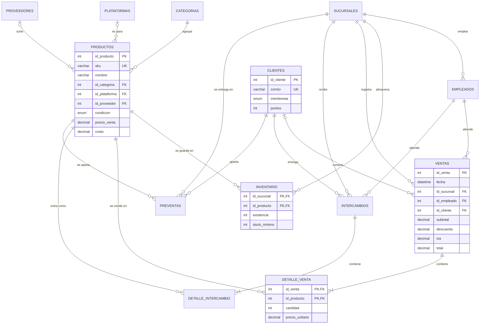

# 🎮 BD-Final: Base de datos de una tienda GameStop

La base de datos de una cadena de tiendas de videojuegos tipo **GameStop** con 4 sucursales en Baja California, hecha de dos formas:

- **MySQL (relacional)**: para abrir y ejecutar en **MySQL Workbench**
- **MongoDB (documental)**: para ejecutar en **mongosh** o **MongoDB Compass**

Guarda las sucursales y sus empleados, los clientes con membresía (Básica o **Pro** con 10% de descuento y puntos), el catálogo (videojuegos nuevos y usados, consolas, accesorios, coleccionables y tarjetas de regalo), el inventario de cada sucursal, las **ventas**, los **intercambios** (cuando el cliente vende sus juegos usados a la tienda) y las **preventas**.

## 📁 Estructura

```
BD-Final/
├── mysql/
│   ├── 01_esquema.sql                 # Crea la BD "gamestop" y sus 14 tablas
│   ├── 02_triggers_procedimientos.sql # 3 triggers, 1 función, 3 procedimientos
│   ├── 03_datos.sql                   # Datos de ejemplo
│   └── 04_vistas_consultas.sql        # 3 vistas y 13 consultas
└── mongodb/
    ├── 01_crear_bd.js                 # Colecciones, validación, datos e índices
    └── 02_consultas.js                # Consultas, agregaciones y CRUD
```

## 🐬 MySQL

### Diagrama entidad-relación



### Tablas (14)

| Grupo | Tablas |
|---|---|
| Tiendas | `sucursales`, `empleados` |
| Clientes | `clientes` |
| Catálogo | `categorias`, `plataformas`, `proveedores`, `productos`, `inventario` |
| Operación | `ventas`, `detalle_venta`, `intercambios`, `detalle_intercambio`, `preventas` |

### Lógica automática

| Objeto | Qué hace |
|---|---|
| `trg_dv_validar_stock` | No deja vender más de lo que hay en la sucursal |
| `trg_dv_despues_insertar` | Al vender: descuenta inventario, calcula subtotal, descuento Pro (10%), IVA (16% incluido) y total, y suma puntos al cliente (1 por cada $10) |
| `trg_di_despues_insertar` | Al recibir un intercambio: suma el usado al inventario y calcula lo pagado |
| `fn_valor_intercambio(producto, forma)` | Lo que paga la tienda por un usado: 30% en efectivo o 40% en crédito |
| `sp_reporte_ventas(inicio, fin)` | Ventas, total y ticket promedio por sucursal |
| `sp_bajo_stock(sucursal)` | Productos en o debajo del stock mínimo |
| `sp_historial_cliente(correo)` | Todas las compras de un cliente |
| Vistas | `v_catalogo`, `v_tickets`, `v_mas_vendidos` |

### Cómo ejecutarlo en MySQL Workbench

1. Abre MySQL Workbench y conéctate a tu servidor local.
2. `File > Open SQL Script…` y abre `mysql/01_esquema.sql`.
3. Ejecuta todo con el rayo ⚡ (`Ctrl+Shift+Enter`).
4. Repite **en orden** con `02`, `03` y `04`.
5. Refresca **Schemas** y aparece la base `gamestop`.
6. Para el diagrama: `Database > Reverse Engineer…`, elige `gamestop` y Workbench dibuja el modelo EER.

> Requiere MySQL 8.0.13 o más reciente.

## 🍃 MongoDB

| Colección | Contenido |
|---|---|
| `sucursales` | Cada sucursal con sus **empleados embebidos** |
| `productos` | Cada producto con su **inventario por sucursal embebido**. Validado con `$jsonSchema` |
| `clientes` | Datos, membresía y puntos |
| `ventas` | Cada ticket con sus **artículos embebidos** (se copia nombre y precio al momento de vender) |
| `intercambios` | Cada intercambio con los usados recibidos |
| `preventas` | Referencias a cliente, producto y sucursal |

Ejemplo de documento de venta:

```json
{
  "_id": 3,
  "fecha": "2026-11-05T13:05:00",
  "sucursal": 2,
  "empleado": 5,
  "cliente": 2,
  "metodo_pago": "Tarjeta",
  "articulos": [
    { "sku": "CON-NS2-STD", "nombre": "Consola Nintendo Switch 2", "cantidad": 1, "precio_unitario": 9499 },
    { "sku": "VJ-NS2-MKW",  "nombre": "Mario Kart World",          "cantidad": 1, "precio_unitario": 1699 }
  ],
  "subtotal": 11198, "descuento": 1119.8, "iva": 1390.09, "total": 10078.2
}
```

Lo que en MySQL hacen los triggers (descontar inventario, totales, puntos), en MongoDB lo hacen las funciones `registrarVenta()` y `registrarIntercambio()` del script. Los resultados son los mismos en las dos bases.

### Cómo ejecutarlo

```bash
mongosh mongodb/01_crear_bd.js
mongosh mongodb/02_consultas.js
```

O en **MongoDB Compass**: abre la pestaña **Mongosh** (abajo), pega el contenido de `01_crear_bd.js` y presiona Enter.

## 🔁 MySQL vs MongoDB

| Concepto | MySQL | MongoDB |
|---|---|---|
| Empleados de una sucursal | Tabla `empleados` con llave foránea | Arreglo `empleados` dentro de la sucursal |
| Inventario | Tabla `inventario` (sucursal + producto) | Arreglo `inventario` dentro del producto |
| Artículos de una venta | Tabla `detalle_venta` | Arreglo `articulos` dentro de la venta |
| Unir datos | `JOIN` | `$lookup` |
| Reglas automáticas | Triggers y procedimientos | Funciones JS en el script |
| Validación | `CHECK`, `FOREIGN KEY`, `ENUM` | `$jsonSchema`, índices únicos |
