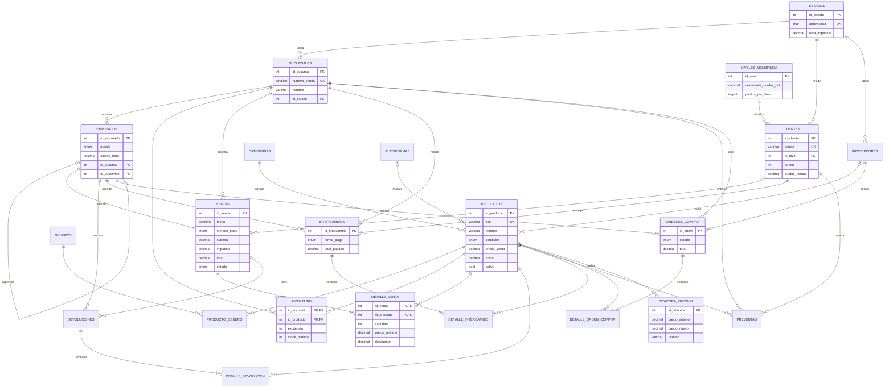
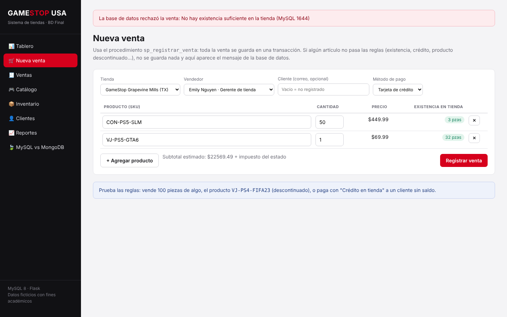
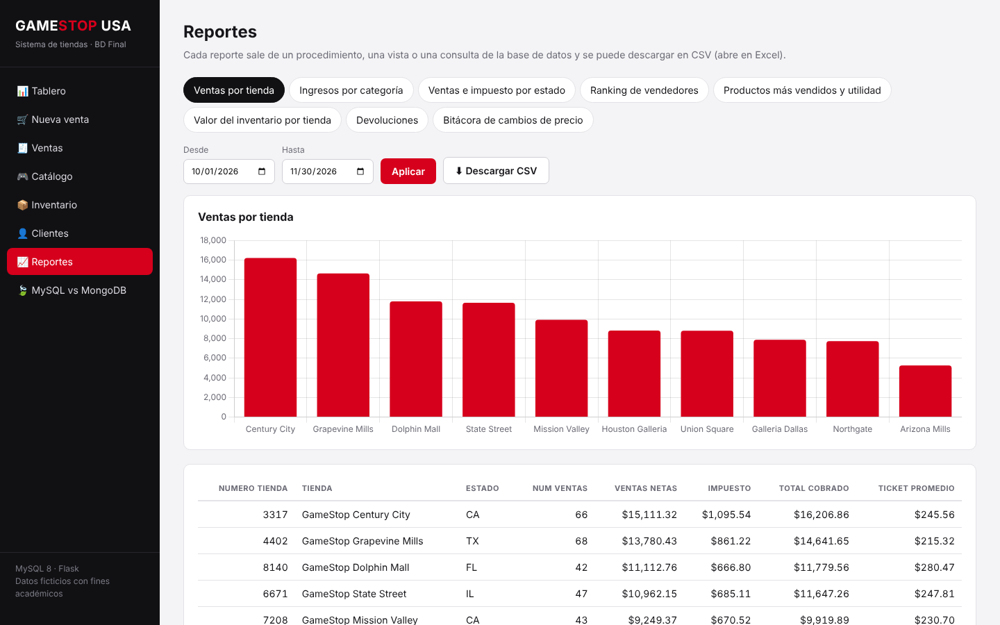
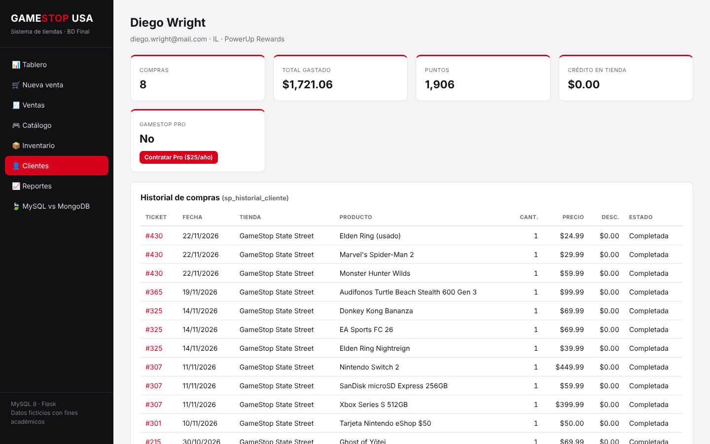

# 🎮 BD-Final: base de datos de GameStop (Estados Unidos)

Base de datos para una cadena de tiendas **GameStop** en Estados Unidos: 10 tiendas en 7 estados, con ventas, inventario, programa de lealtad (PowerUp Rewards / GameStop Pro), intercambio de juegos usados, devoluciones, preventas y compras a proveedores.

Está hecha de dos formas:

| | Motor | Herramienta |
|---|---|---|
| 🐬 **Relacional** | MySQL 8.0 | MySQL Workbench |
| 🍃 **Documental** | MongoDB 6+ | mongosh / MongoDB Compass |

Incluye además una **interfaz web en Flask**, los **scripts de migración y validación** MySQL → MongoDB y la documentación de **análisis**.


Las dos versiones tienen **exactamente los mismos datos**, del 1 de octubre al 23 de noviembre de 2026, que incluye el lanzamiento de GTA VI y las ofertas anticipadas de Black Friday.


## 👥 Equipo

| Integrante | GitHub |
|---|---|
| Carlos | [@carlos03123](https://github.com/carlos03123) |
| Celeste Grageda | [@celestegrageda](https://github.com/celestegrageda) |

## ✅ Cómo cubre la rúbrica del proyecto

| Criterio | Dónde está |
|---|---|
| **Análisis** | [`docs/analisis.md`](docs/analisis.md): problema, objetivos, actores, 15 requerimientos funcionales, 16 reglas de negocio, requerimientos no funcionales, casos de uso y entidades |
| **Estructura de la BD** | [`mysql/01_esquema.sql`](mysql/01_esquema.sql) con 22 tablas, el diagrama E-R (abajo), el [diccionario de datos](docs/diccionario_datos.md) y la [normalización 1FN–3FN](docs/normalizacion.md) |
| **Funciones, procedimientos, consultas y reportes** | 4 funciones y 9 triggers ([`02`](mysql/02_funciones_triggers.sql)), 9 procedimientos ([`03`](mysql/03_procedimientos.sql)), 7 vistas ([`05`](mysql/05_vistas.sql)), 30 consultas ([`06`](mysql/06_consultas.sql)), seguridad ([`07`](mysql/07_seguridad.sql)), pruebas ([`08`](mysql/08_pruebas.sql)) y 8 reportes exportables a CSV en la interfaz |
| **Migración, estructura NoSQL y validación** | [`migracion/migrar.py`](migracion/migrar.py) convierte las 22 tablas en 10 colecciones. [`mongodb/01_colecciones.js`](mongodb/01_colecciones.js) tiene validación `$jsonSchema`, índices y vistas. [`migracion/validar.py`](migracion/validar.py) hace 52 pruebas de que MySQL y MongoDB coinciden |
| **Presentación (UI) y cierre (repo)** | Interfaz web en [`app/`](app/) y este repositorio documentado |

---

## 📁 Estructura

```
BD-Final/
├── mysql/
│   ├── 01_esquema.sql               22 tablas con PK, FK, CHECK, UNIQUE, ENUM e índices
│   ├── 02_funciones_triggers.sql    4 funciones y 9 triggers (reglas de negocio)
│   ├── 03_procedimientos.sql        9 procedimientos (transacciones, cursor, JSON_TABLE)
│   ├── 04_datos.sql                 Datos de ejemplo cargados en orden cronológico
│   ├── 05_vistas.sql                7 vistas
│   ├── 06_consultas.sql             30 consultas de básicas a avanzadas
│   ├── 07_seguridad.sql             4 roles y 5 usuarios con privilegios
│   └── 08_pruebas.sql               Pruebas de reglas de negocio y transacciones
├── mongodb/
│   ├── 01_colecciones.js            Colecciones con $jsonSchema, índices y vistas
│   ├── 02_datos.js                  Los mismos datos que MySQL (generado por migracion/migrar.py)
│   ├── 03_operaciones.js            Reglas de negocio en JavaScript + pruebas
│   └── 04_consultas.js              Consultas y agregaciones
├── migracion/
│   ├── migrar.py                    MySQL → MongoDB (directo o generando 02_datos.js)
│   ├── validar.py                   52 pruebas: conteos, totales, referencias, $jsonSchema
│   └── conexion.py                  Datos de conexión por variables de entorno
├── app/                             Interfaz web (Flask)
│   ├── app.py                       Rutas: tablero, ventas, catálogo, inventario, clientes, reportes
│   ├── db.py
│   ├── templates/                   Páginas HTML
│   └── static/                      Estilos y Chart.js (funciona sin internet)
├── docs/
│   ├── analisis.md                  Problema, requerimientos, reglas de negocio, casos de uso
│   ├── diccionario_datos.md         Todas las columnas de todas las tablas
│   ├── normalizacion.md             1FN, 2FN, 3FN y diseño documental
│   └── capturas/                    Capturas de la interfaz
└── requirements.txt                 flask, pymysql, pymongo
```

## 📊 Contenido

| Datos | Cantidad |
|---|---|
| Tiendas | 10 (TX, CA, NY, FL, IL, AZ, WA) |
| Empleados | 45 (con organigrama: gerentes de distrito → gerentes → subgerentes → asesores) |
| Clientes | 60 (≈ 40 % con GameStop Pro) |
| Productos | 67 (videojuegos nuevos y usados, consolas, accesorios, coleccionables, tarjetas) |
| Ventas | 473 tickets con 772 renglones de detalle |
| Intercambios | 30 · **Devoluciones:** 14 · **Preventas:** 23 · **Órdenes de compra:** 19 |
| Cambios de precio en la bitácora | 10 |

> Los nombres de personas, direcciones, teléfonos y correos son **ficticios**, creados con fines académicos. Los precios están en dólares (USD).

---

## 🐬 MySQL

### Diagrama entidad-relación



Las columnas de todas las tablas están en el [diccionario de datos](docs/diccionario_datos.md), y la justificación del modelo en [normalización](docs/normalizacion.md).

### Reglas de negocio automáticas

| Regla | Dónde |
|---|---|
| No se puede vender más de lo que hay en la tienda | `trg_detalle_venta_bi` |
| No se venden productos descontinuados | `trg_detalle_venta_bi` |
| El cliente GameStop Pro vigente tiene **10 % de descuento en usados** | `trg_detalle_venta_bi` + `fn_es_pro` |
| El pago con crédito en tienda requiere saldo suficiente | `trg_detalle_venta_bi` |
| Al vender se descuenta el inventario y se calculan subtotal, descuento, **impuesto según el estado** y total | `trg_detalle_venta_ai` + `fn_tasa_impuesto` |
| Puntos de lealtad: 1 por dólar (2 si es Pro) | `trg_detalle_venta_ai` |
| Devoluciones solo dentro de 30 días y sin pasar de lo comprado | `trg_detalle_devolucion_bi` |
| La devolución regresa el inventario, reembolsa con impuesto y quita los puntos | `trg_detalle_devolucion_ai` |
| En intercambio solo entran productos usados o reacondicionados | `trg_detalle_intercambio_bi` |
| La tienda paga 25 % en efectivo o 35 % en crédito (+10 % de bono para Pro) | `fn_valor_intercambio` |
| El precio nunca puede ser menor al costo | `trg_productos_bu` + `CHECK` |
| Cada cambio de precio queda en la bitácora con usuario y fecha | `trg_productos_au` |

### Procedimientos almacenados

| Procedimiento | Qué demuestra |
|---|---|
| `sp_registrar_venta` | Venta completa en una **transacción**. Recibe los artículos como **JSON** (`JSON_TABLE`) y hace `ROLLBACK` si algo falla |
| `sp_recibir_orden` | Transacción con `SELECT … FOR UPDATE` que suma la mercancía al inventario |
| `sp_generar_reabasto` | Usa un **cursor** para crear una orden por proveedor con lo que está bajo el mínimo |
| `sp_transferir_inventario` | Mueve mercancía entre tiendas dentro de una transacción |
| `sp_renovar_pro` | Contrata o renueva GameStop Pro por un año |
| `sp_ajustar_precios` | Aplica ofertas por categoría y plataforma (la bitácora se llena sola) |
| `sp_reporte_ventas`, `sp_bajo_stock`, `sp_historial_cliente` | Reportes |

### Consultas (`06_consultas.sql`)

Son 30 consultas en seis grupos:

- **A. Básicas:** `WHERE`, `LIKE`, `BETWEEN`, `IN`, `ORDER BY`.
- **B. JOINs:** `INNER`, `LEFT`, auto-JOIN y JOINs de 5 tablas.
- **C. Agregación:** `GROUP BY` y `HAVING`.
- **D. Subconsultas:** `IN`, `EXISTS`, `NOT EXISTS` y correlacionadas.
- **E. Avanzadas:** `WITH` (CTE); funciones de ventana `ROW_NUMBER`, `RANK`, `LAG`, `FIRST_VALUE` y promedio móvil; `CASE` y `UNION ALL`.
- **F. Vistas y procedimientos.**

### Seguridad (`07_seguridad.sql`)

| Rol | Puede |
|---|---|
| `rol_admin` | Todo |
| `rol_gerente` | Consultar, insertar y modificar. **No puede borrar** |
| `rol_vendedor` | Ver catálogo e inventario y registrar ventas, intercambios, devoluciones y preventas. De los clientes solo puede modificar **teléfono y correo** (privilegio por columna) |
| `rol_analista` | Solo **vistas** y reportes. No ve las tablas con datos personales |

Uno de los usuarios tiene caducidad de contraseña y bloqueo tras 5 intentos fallidos.

### ▶️ Cómo ejecutarlo en MySQL Workbench

1. Abre MySQL Workbench y conéctate con tu usuario `root`.
2. `File → Open SQL Script…` y abre `mysql/01_esquema.sql`.
3. Ejecuta el script completo con el rayo ⚡ (`Ctrl + Shift + Enter`).
4. Repite **en orden** con `02`, `03`, `04`, `05`, `06` y `07`.
5. Opcional: ejecuta `08_pruebas.sql` para ver cómo se rechazan las operaciones inválidas. Este script modifica datos; para volver al inicio, corre otra vez del `01` al `05`.
6. Refresca el panel **Schemas** y aparece la base `gamestop_usa`.
7. **Diagrama EER:** `Database → Reverse Engineer…`, elige `gamestop_usa` y Workbench dibuja el modelo con todas las relaciones.

> Requiere **MySQL 8.0.13 o superior** (usa `CHECK`, `JSON_TABLE`, funciones de ventana, CTE y roles).

---

## 🍃 MongoDB

| Colección | Qué guarda | Embebido |
|---|---|---|
| `sucursales` | Tiendas | Estado (con impuesto) y **empleados** |
| `productos` | Catálogo (`_id` = SKU) | **Inventario por tienda** y géneros |
| `clientes` | Clientes | Membresía |
| `ventas` | Tickets | **Artículos y devoluciones** |
| `intercambios`, `ordenes_compra` | Operaciones | Artículos |
| `preventas`, `proveedores`, `niveles_membresia`, `bitacora_precios` | — | — |

Ejemplo de una venta:

```js
{
  _id: 250,
  fecha: ISODate("2026-11-04T12:40:00Z"),
  sucursal: { _id: 5, nombre: "GameStop Mission Valley", estado: "CA" },
  empleado: { _id: 24, nombre: "Alexis Nguyen" },
  cliente: 40,                                   // referencia a clientes
  metodo_pago: "Efectivo",
  articulos: [
    { sku: "ACC-PS5-DSE", nombre: "Control DualSense Edge", categoria: "Accesorio",
      condicion: "Nuevo", cantidad: 1, precio_unitario: 199.99, descuento: 0 }
  ],
  subtotal: 199.99, descuento: 0, impuesto: 14.5, total: 214.49,
  estado: "Completada"
}
```

La versión MongoDB incluye:

- **Validación** con `$jsonSchema` en todas las colecciones principales, más una regla `$expr` (precio ≥ costo).
- **Índices:** únicos, compuestos, multikey y de texto.
- **4 vistas:** `v_ventas_tienda`, `v_catalogo`, `v_inventario_valorizado` y `v_ventas_diarias`.
- **Reglas de negocio** en `03_operaciones.js`: `registrarVenta()`, `registrarDevolucion()`, `registrarIntercambio()`, `recibirOrden()` y `cambiarPrecio()`. Corren en **transacción** si el servidor es un replica set, como MongoDB Atlas.
- **Consultas** con `$lookup`, `$unwind`, `$group`, `$bucket`, `$facet`, `$setWindowFields` (ranking, acumulado, promedio móvil) y búsqueda de texto.

### ▶️ Cómo ejecutarlo

Desde una terminal, en la carpeta del proyecto:

```bash
mongosh mongodb/01_colecciones.js
mongosh mongodb/02_datos.js
mongosh mongodb/04_consultas.js
mongosh mongodb/03_operaciones.js   # opcional: modifica datos
```

En **MongoDB Compass**: abre la pestaña **Mongosh** (abajo), pega el contenido de cada archivo en ese orden y presiona Enter.

---

## 🔄 Migración y validación (MySQL → MongoDB)

Primero carga MySQL (archivos `01` a `05`) y crea las colecciones con `mongosh mongodb/01_colecciones.js`. Después:

```bash
pip install -r requirements.txt

# Windows (PowerShell):  $env:MYSQL_PASSWORD="tu_contraseña"
# Mac / Linux:           export MYSQL_PASSWORD="tu_contraseña"

python migracion/migrar.py                                     # migra las 22 tablas a 10 colecciones
python migracion/validar.py --reporte docs/reporte_validacion.md
```

`migrar.py` **transforma** el modelo: los empleados quedan dentro de su tienda, el inventario y los géneros dentro del producto, y los artículos y devoluciones dentro de la venta. Como las colecciones tienen validadores `$jsonSchema`, MongoDB rechaza cualquier documento mal formado durante la migración. `mongodb/02_datos.js` se generó con este mismo script (`python migracion/migrar.py --js mongodb/02_datos.js`).

`validar.py` compara las dos bases y genera un reporte con:

- **Conteos** de cada tabla contra su colección o arreglo embebido.
- **Totales**: ventas, impuestos, reembolsos, inventario, puntos y crédito, en general, por tienda, por producto y por cliente.
- **Integridad referencial** dentro de MongoDB: que no haya referencias huérfanas.
- Que **ningún documento viole su `$jsonSchema`**.
- **25 ventas al azar** comparadas campo por campo.

Variables de conexión opcionales: `MYSQL_HOST`, `MYSQL_PORT`, `MYSQL_USER` (por defecto `root`), `MYSQL_DB`, `MONGO_URI` (por defecto `mongodb://localhost:27017`).

---

## 🖥️ Interfaz web

```bash
pip install -r requirements.txt
# define MYSQL_PASSWORD como arriba
python app/app.py
```

Luego abre **http://127.0.0.1:5000**.

| Página | Qué hace | Objetos de la BD que usa |
|---|---|---|
| **Tablero** | Indicadores, ventas diarias, ventas por tienda y por categoría, productos más vendidos | `v_ventas_diarias`, `sp_reporte_ventas`, `v_ventas_producto`, `v_inventario_valorizado`, `fn_es_pro` |
| **Nueva venta** | Registra una venta con varios productos y muestra la existencia en vivo. Si una regla no se cumple, muestra el mensaje del trigger | `sp_registrar_venta` (transacción + JSON) y todos los triggers de venta |
| **Ventas / Ticket** | Lista con filtros, detalle del ticket y registro de devoluciones | `v_tickets`, triggers de devolución |
| **Catálogo** | Búsqueda y filtros; cambio de precio | `v_catalogo`, `trg_productos_bu`, `trg_productos_au` (bitácora) |
| **Inventario** | Existencias por tienda, alertas de mínimo, reabasto automático, recepción de órdenes y transferencias | `sp_generar_reabasto`, `sp_recibir_orden`, `sp_transferir_inventario` |
| **Clientes** | Gasto, puntos, crédito y vigencia Pro; historial, intercambios, preventas; renovar Pro | `v_clientes_resumen`, `sp_historial_cliente`, `sp_renovar_pro` |
| **Reportes** | 8 reportes con gráfica y descarga en **CSV** (abre en Excel) | `sp_reporte_ventas`, vistas y consultas con `RANK()` |
| **MySQL vs MongoDB** | Compara en vivo las dos bases y muestra un documento de ejemplo | MySQL + MongoDB |

| | |
|---|---|
|  |  |
| *La base de datos rechaza una venta sin existencia* | *Inventario con alertas de reabasto* |
|  |  |
| *Reportes exportables a CSV* | *Ficha del cliente* |

---

## 🔁 MySQL vs MongoDB en este proyecto

| Concepto | MySQL | MongoDB |
|---|---|---|
| Artículos de una venta | Tabla `detalle_venta` + JOIN | Arreglo `articulos` dentro de la venta |
| Inventario | Tabla `inventario` (tienda × producto) | Arreglo `inventario` dentro del producto |
| Géneros de un juego | Tabla N:M `producto_genero` | Arreglo `generos` |
| Empleados y jefes | FK recursiva `id_supervisor` | Arreglo en la tienda + `$lookup` con pipeline |
| Unir colecciones | `JOIN` | `$lookup` |
| Reglas de negocio | Triggers y procedimientos | Funciones en JavaScript |
| Transacciones | `START TRANSACTION … COMMIT / ROLLBACK` | `session.withTransaction()` (replica set) |
| Validación | `CHECK`, `FOREIGN KEY`, `ENUM`, `UNIQUE` | `$jsonSchema`, `$expr`, índices únicos |
| Ranking / acumulados | `ROW_NUMBER()`, `RANK()`, `SUM() OVER` | `$setWindowFields` |
| Permisos | Roles y privilegios por tabla y columna | Roles de MongoDB (no incluidos) |
